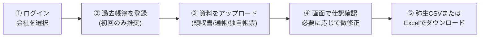

# 📘 AI会計仕訳作成アシスタント 使い方マニュアル (ユーザーガイド)

本マニュアルは、「AI会計仕訳作成アシスタント」を初めて利用される方向けの操作手順書です。  
領収書・通帳・独自帳票の画像やPDFをアップロードするだけで、高精度な仕訳データを自動作成し、**弥生会計形式（CSV）やExcel形式で簡単に出力**できます。

---

## 📑 目次

1. [全体の流れ（3分でわかる使い方）](#1-全体の流れ)
2. [ログインと初期設定](#2-ログインと初期設定)
   - ログイン・新規登録
   - 会社の選択と作成
   - チームメンバーの招待
3. [【精度UPの秘訣】過去帳簿の学習設定](#3-過去帳簿の学習設定)
   - 過去帳簿を登録するメリット
   - 登録手順（仕訳日記帳・総勘定元帳・補助残高一覧表）
4. [仕訳を作成する（3つのモード）](#4-仕訳を作成する)
   - ① 📄 領収書モード（レシート・請求書）
   - ② 🏦 通帳モード（預金通帳・複数ページPDF）
   - ③ 📋 会社専用カスタムモード（独自帳票・日計表等）
5. [仕訳結果の確認と編集](#5-仕訳結果の確認と編集)
   - 画面の見方（元画像と仕訳の対照表示）
   - 全幅表示モードへの切り替え
   - データの修正と一括変更
6. [仕訳データの出力（弥生会計・Excel）](#6-仕訳データの出力)
   - 弥生会計用CSVの出力
   - Excelファイルの出力
7. [解析履歴の確認・復元](#7-解析履歴の確認と復元)
8. [よくある質問 (FAQ)](#8-よくある質問)

---

## 1. 全体の流れ



---

## 2. ログインと初期設定

### 2-1. ログイン・新規登録
1. 発行されたURLにブラウザでアクセスします。
2. **メールアドレスとパスワード**を入力してログインします。
   - 初めて利用する方は「新規アカウント登録」タブから登録を行ってください。
   - 招待メールを受け取った方は、メール内の招待リンクからパスワードを設定してご参加ください。

### 2-2. 会社の選択と作成
本システムは**複数会社（マルチテナント）に対応**しています。
* **現在の会社を確認する**: 画面右上の会社名バッジ（例: `株式会社サンプル`）で、現在どの会社の作業スペースを開いているか確認できます。
* **会社を切り替える**: 会社名をクリックするとドロップダウンが表示され、所属している別の会社にワンクリックで切り替えられます。
* **新しい会社を作成する**: ドロップダウン下部の **「＋ 新しい会社を作成」** を押すと、新しい会社の作業スペースを作成できます（作成したユーザーがオーナー権限になります）。

### 2-3. チームメンバーの招待
同じ会社で他のメンバーと一緒に作業する場合、招待機能を利用します。
1. 画面右上の会社メニューを開き、**「👥 メンバー管理・招待」** をクリックします。
2. 招待したいメンバーの **メールアドレス** と **権限（管理者またはメンバー）** を設定し、「招待状を送信」をクリックします。
3. 招待されたメンバーにはメールが届き、リンクを開くことで同じ会社スペースにログインできるようになります。

---

## 3. 過去帳簿の学習設定

> [!TIP]
> **仕訳の精度を劇的に向上させるための最重要ステップです！**  
> あらかじめ前期や前々期の帳簿をアップロードしておくと、AIが**「御社特有の取引先・摘要と勘定科目・補助科目の対応ルール」**を自動学習し、最優先でそのルールを適用してくれます。

### 3-1. 登録できる帳簿（前期・前々期）
画面上部の **「📚 過去帳簿・仕訳学習」** ボタンから設定画面に移動します。

| 帳簿タイプ | 推奨形式 | 活用される内容 |
| :--- | :--- | :--- |
| **📑 仕訳日記帳** | CSV, Excel, TSV | 日々の仕訳履歴。取引先・摘要と勘定科目の対応ルールを最も詳細に学習します（**推奨**）。 |
| **📖 総勘定元帳** | CSV, Excel, TSV | 科目ごとの取引推移。どの取引先にどの勘定科目を使っていたかを補完学習します。 |
| **📊 補助残高一覧表** | CSV, Excel, TSV | 銀行口座名や主要取引先の補助科目対応ルールを学習します。 |

### 3-2. アップロード方法
1. **「📅 前期分（1年前）」** または **「📅 前々期分（2年前）」** のタブを選択します。
2. 各カードの枠内に、会計ソフトから出力したCSVまたはExcelファイル（`.xlsx`）をドラッグ＆ドロップします。
   - 弥生会計等から出力された **Shift_JIS形式のCSVでも文字化けせず自動認識** されます。
3. アップロードが完了すると、**「抽出ルール: ○○件」** と表示されます。
4. **「▼ 抽出された仕訳ルールを確認」** をクリックすると、実際にAIが学習したルール（入金・出金、キーワード、勘定科目）の一覧を確認できます。

---

## 4. 仕訳を作成する

メイン画面上部のタブから、資料の種類に合わせてモードを選択します。

### ① 📄 領収書モード
* **対象資料**: レシート、領収書、請求書（画像ファイル: JPG, PNG, WebP、または PDF）
* **特徴**:
  * 店舗名、支払先、取引日、合計金額を自動読み取り。
  * **複数税率（10%対象・8%軽減税率対象）が混在している場合、自動で2行の仕訳に分割作成** します。
  * 過去帳簿に実績がある取引先は、その勘定科目・税区分・補助科目が自動適用されます。

### ② 🏦 通帳モード
* **対象資料**: 預金通帳（画像、または複数ページの通帳PDF）
* **特徴**:
  * 「1行＝1明細」の原則を厳格に維持し、印字行を正確に抽出します。
  * **複数ページのPDF** でも、全ページを一括で順番に解析します。
  * 「お支払い金額」「お預り金額」から出金・入金を自動判別し、安易な「仮払金」「仮受金」ではなく、**水道光熱費・通信費・支払手数料・買掛金・売掛金・受取利息などの実科目**を自動判定します。
  * 相手先会社名やカード会社名が自動的に**補助科目欄**にセットされます。

### ③ 📋 会社専用カスタムモード（独自フォーマット資料）
一般的な領収書や通帳とは異なる、**クライアント企業独自の帳票**（例: POSレジ売上日計表、独自請求書、特定の業務システム出力、ECサイト明細など）に対応する機能です。

#### 使い方:
1. モードタブ右端の **「➕ 専用モード追加」** をクリックします。
2. モード名（例: `POSレジ日計表モード`）を入力します。
3. **プロンプト（仕訳作成の指示文）** を入力します。
   - 画面上部の **「💡 テンプレート例文から選んで入力」** をクリックすると、雛形（POSレジ日計表、独自納品書、カード明細など）が自動セットされるので、微修正するだけで簡単に作れます。
4. 保存すると、画面上部に専用のモードタブ（例: `📊 POSレジ日計表`）が新設されます。
5. そのタブを選んで資料をアップロードすると、**あなたが書いた指示通りにAIが仕訳を作成** します。

---

## 5. 仕訳結果の確認と編集

AI解析が完了すると、画面が2分割（スプリットビュー）で表示されます。

```
┌─────────────────────────┬────────────────────────────────────────────────────────┐
│  左側: 元資料プレビュー   │  右側: スプレッドシート型 仕訳一覧テーブル              │
│                         │                                                        │
│  [アップロードした資料]  │  ☑ | 取引日 | 相手先 | 借方科目 | 借方補助 | ... | 摘要 │
│  拡大・縮小・ページ切替  │  ----------------------------------------------------  │
│                         │  直接セルに入力して修正できます                          │
└─────────────────────────┴────────────────────────────────────────────────────────┘
```

### 5-1. 全幅表示モード（プレビューの折りたたみ）
仕訳テーブル上部の **「⤢ 全幅表示 (プレビューを隠す)」** ボタンをクリックすると、プレビューが一時的に隠れ、画面横幅いっぱいにすべての仕訳欄が広々と表示されます（再度クリックでいつでも元に戻せます）。

### 5-2. 画面上の編集機能
* **直接編集**: 日付、相手先、勘定科目、補助科目、税区分、金額、摘要のすべてのセルは、クリックしてキーボードから直接打ち替えることができます。
* **要確認バッジ（黄色背景）**: AIが読み取りに自信が持てなかった箇所は黄色（要確認）で強調表示されます。内容を確認し、必要に応じて修正してください。
* **一括変更機能**:
  * 複数行のチェックボックス（☑）にチェックを入れ、テーブル上部の「科目一括変更」「税区分一括変更」を実行すると、選択した仕訳を一括で変更できます。
* **行の削除**: 右端の赤いゴミ箱アイコンをクリックすると、不要な仕訳行を1行ずつ削除できます。

---

## 6. 仕訳データの出力

内容の確認・編集が完了したら、会計ソフトやExcelへ出力します。

### 6-1. 弥生会計用CSVの出力
1. 画面右下の **「弥生会計用CSVをダウンロード」** ボタンをクリックします。
2. 弥生会計のインポート仕様（25項目・単行仕訳形式、Shift_JIS / CP932）に準拠したCSVファイルがダウンロードされます。
3. 弥生会計のメニュー **「帳簿・伝票」➔「仕訳日記帳」➔「ファイル」➔「インポート」** からそのまま取り込むことができます。

### 6-2. Excelファイルの出力
1. **「Excelをダウンロード」** ボタンをクリックします。
2. 以下の2シート構成の `.xlsx` ファイルが出力されます：
   * **シート1「仕訳明細一覧」**: 補助科目や元ファイル名を含む見やすい明細テーブル。
   * **シート2「勘定科目別集計」**: 借方・貸方それぞれの科目別合計金額サマリー。

---

## 7. 解析履歴の確認と復元

* 画面右上の **「📜 解析履歴」** ボタンをクリックすると、これまでに解析した過去の履歴一覧が表示されます。
* 過去の解析結果は**クラウドデータベース（Supabase）に安全に保存**されており、**どの端末・どのメンバーのアカウントからログインしても同じ履歴を確認**できます。
* **「仕訳を復元」** ボタンを押すと、過去の解析結果をいつでも作業画面に呼び出して再編集や再ダウンロードが可能です。

---

## 8. よくある質問 (FAQ)

### Q1. 会計ソフトから出力したCSVが文字化けして読み込めません。
> **A.** 本システムは、日本の会計ソフトで標準的な **Shift_JIS (CP932) および UTF-8 を自動判別** してデコードします。そのままアップロードして問題ありません。もし読み込めない場合は、Excel（`.xlsx`）形式で保存してアップロードしてください。

### Q2. 軽減税率（8%）と標準税率（10%）が1枚のレシートに混ざっている場合はどうなりますか？
> **A.** AIが自動的に税率ごとの小計を判別し、**10%分の仕訳と8%分の仕訳の2行に自動分割**して出力します。

### Q3. 「専用モード」で書いたプロンプトは他のメンバーにも共有されますか？
> **A.** はい。会社ごとに登録されるため、同じ会社に所属している全メンバーが同じ専用モード・同じプロンプトを利用できます。

### Q4. 別の会社に切り替えたら、仕訳データが混ざりませんか？
> **A.** 混ざりません。会社ごとに作業スペースが完全に独立しており、会社を切り替えると仕訳一覧画面や過去帳簿、専用モードもすべてその会社専用の内容に瞬時に切り替わります。
